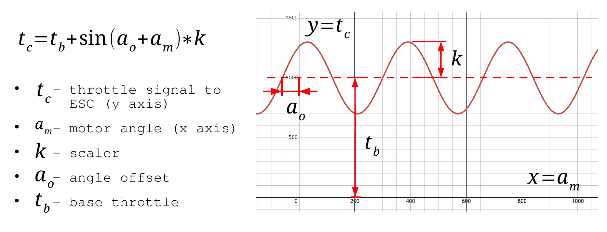

# STM32F4 Firmware for a swashplateless cyclic blade pitch controller

This STM32F4 firmware generates a Dshot2400 throttle signal with an appropirate sine wave component given the following input parameters (via i2c packets): base throttle, angle offset and scaler (see image below) 

The throttle output update rate is around 14 kHz with the current firmware, utilising a simplified sine function or potentially some form of lookup table should allow for much higher loop rates.

**TODO - add i2c packet structure, wiring diagrams and parts lists**

## Applications of this firmware

- [Flying stick](https://www.reddit.com/r/TheOwlHouse/comments/qzo8fo/irl_staff_palisman_further_tuning_much_more_stable/)
  
- [Evaluation of flexibly coupled lag-pitch hinges for swashplateless cyclic blade pitch control systems](https://github.com/MacroMelon/thrust-torque-measurer/blob/master/design_and_characterisation_of_flexible_living_lag-pitch_highes_in_swashplateless_cyclic_blade_pitch_control_systems_fixed_macromelon_smol.pdf)

